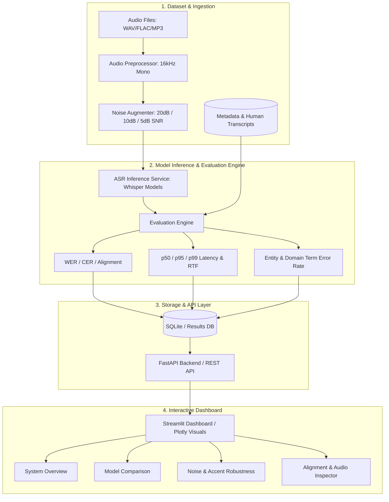
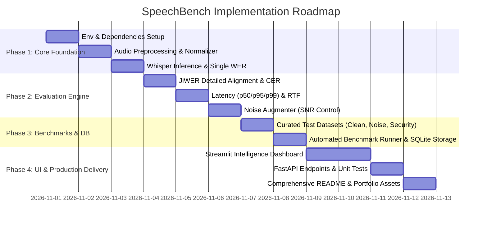

# SpeechBench: Speech Recognition Evaluation Platform — Implementation Plan

> **Target Goal**: Build an end-to-end ASR Benchmarking and Speech Intelligence Evaluation Platform that evaluates speech recognition models (Whisper Tiny, Base, Small, and extensible to others) across acoustic noise conditions, accent diversity, audio lengths, and domain-specific terminology (security control rooms, incident response, call centers).

---

## 1. System Architecture & Component Design



---

## 2. Directory Structure

```text
SpeechBench/
├── app/
│   ├── __init__.py
│   ├── main.py                  # FastAPI application entrypoint
│   ├── api/
│   │   ├── __init__.py
│   │   ├── routes_transcribe.py # Audio upload & one-off transcription
│   │   ├── routes_evaluate.py   # On-demand evaluation endpoint
│   │   └── routes_benchmark.py  # Batch benchmark triggering & status
│   ├── services/
│   │   ├── __init__.py
│   │   ├── audio_processor.py   # Resampling, mono, normalization, duration check
│   │   ├── noise_augmenter.py   # Gaussian/ambient noise injection at target SNRs
│   │   ├── asr_service.py       # Whisper model loading, inference & warm-up
│   │   ├── evaluation_service.py# WER, CER, Sub/Del/Ins alignment, Entity Error Rate
│   │   └── normalizer.py        # Text cleaning, case/punctuation handling
│   ├── database/
│   │   ├── __init__.py
│   │   ├── db.py                # SQLite connection & session management
│   │   └── models.py            # BenchmarkRun, AudioSample, Prediction records
│   └── dashboard/
│       ├── __init__.py
│       ├── app.py               # Streamlit multi-page / tabbed application
│       ├── components/          # Reusable Plotly charts and metrics cards
│       └── views/               # Overview, Model Comparison, Robustness, Error Inspector
├── datasets/
│   ├── audio/
│   │   ├── clean/               # Clean read speech (LibriSpeech subset)
│   │   ├── accents/             # Diverse accents (Common Voice subset)
│   │   └── domain_security/     # Security control room / dispatch terminology
│   ├── noise_profiles/          # Background office, radio chatter, street noise
│   └── metadata.csv             # Ground truth transcripts & speaker/condition metadata
├── experiments/
│   ├── run_benchmark.py         # CLI runner for automated benchmark sweeps
│   ├── run_noise_sweep.py       # Noise level degradation tests (clean -> 5dB)
│   └── run_domain_eval.py       # Specialized security & entity evaluation
├── results/
│   ├── benchmark_results.csv    # Exported evaluation run metrics
│   └── detailed_alignments.json # Per-word substitution/deletion/insertion traces
├── tests/
│   ├── test_audio_processor.py  # Unit tests for audio preprocessing
│   ├── test_noise_augmenter.py  # Unit tests for SNR calculations
│   ├── test_metrics.py          # Unit tests for WER, CER, and normalizer
│   └── test_api.py              # FastAPI endpoint tests
├── requirements.txt
├── .gitignore
└── README.md                    # In-depth report with benchmark findings & interview guide
```

---

## 3. Phased Implementation Roadmap



### Phase 1: Environment, Audio Processing & Core ASR Engine
- [ ] **Virtual Environment Setup**:
  - Python 3.11 virtual environment in `SpeechBench/venv`.
  - Install core packages: `torch torchaudio` (CUDA-enabled if GPU available), `openai-whisper`, `librosa`, `soundfile`, `jiwer`, `pandas`, `numpy`, `streamlit`, `plotly`, `fastapi`, `uvicorn`, `pytest`.
  - Ensure FFmpeg is accessible (bundled via `imageio-ffmpeg` or system binary).
- [ ] **Audio Preprocessor (`audio_processor.py`)**:
  - Load audio formats (WAV, MP3, FLAC).
  - Stereo to mono conversion.
  - Resampling to 16 kHz (standard Whisper sample rate).
  - Peak normalization and audio validation (detecting silence, corrupted files, clipping).
- [ ] **Text Normalizer (`normalizer.py`)**:
  - Consistent casing (lowercasing).
  - Punctuation stripping/handling.
  - Number words to digits conversion or standardized regex.
  - Preservation of both raw and normalized transcripts for inspection.
- [ ] **Whisper Inference Engine (`asr_service.py`)**:
  - Model loader supporting `tiny`, `base`, `small`.
  - Device dispatch (CUDA GPU if available, else CPU).
  - GPU warmup pass to ensure clean timing.
  - Synchronized inference timing (`torch.cuda.synchronize()` for GPU).

### Phase 2: Comprehensive Evaluation Engine & Noise Augmenter
- [ ] **Evaluation Engine (`evaluation_service.py`)**:
  - Word Error Rate (WER) and Character Error Rate (CER) via `jiwer`.
  - Full error classification: Counts of Substitutions ($S$), Deletions ($D$), and Insertions ($I$).
  - Word-level alignment visualizer (highlighting replaced words, missing words, and hallucinations).
  - Latency metrics: Wall-clock latency, Real-Time Factor ($RTF = \frac{T_{proc}}{T_{audio}}$).
- [ ] **Noise Augmentation Engine (`noise_augmenter.py`)**:
  - Signal-to-Noise Ratio (SNR) formula:
    $$SNR_{dB} = 10 \log_{10}\left(\frac{P_{signal}}{P_{noise}}\right)$$
  - Generate calibrated noisy variants: Clean (no added noise), 20 dB (light), 10 dB (moderate), 5 dB (heavy).
  - Additive background audio (chatter, street, static white/pink noise).
- [ ] **Domain-Specific Entity Evaluation**:
  - Security control room vocabulary extraction (e.g., Gate IDs, building numbers, incident codes, phonetic alpha-numerics).
  - Entity Error Rate (EER) calculating accuracy on critical keywords versus general filler words.

### Phase 3: Benchmarking Pipeline & SQLite Persistence
- [ ] **Dataset Assembly**:
  - Curate initial 100–150 samples across:
    1. Clean Speech (LibriSpeech test-clean).
    2. Noisy speech (synthesized across SNRs).
    3. Diverse speaker/accent recordings.
    4. Security & Dispatch Domain test sentences (addresses, incident descriptions, gate codes).
  - Unified `metadata.csv` with audio path, speaker ID, accent tag, audio duration, and ground-truth text.
- [ ] **Automated Benchmark Runner (`experiments/run_benchmark.py`)**:
  - Sweep models (`tiny`, `base`, `small`) across conditions.
  - Calculate distribution metrics: Mean, Median (p50), 95th Percentile (p95), 99th Percentile (p99).
  - Export structured CSV and JSON outputs.
- [ ] **Database Schema (`database/models.py` & `db.py`)**:
  - `BenchmarkRun`: Run ID, timestamp, hardware specs, model list.
  - `AudioRecord`: Filepath, duration, condition (clean, SNR level, accent).
  - `EvaluationResult`: Model, predicted text, reference text, WER, CER, S/D/I counts, latency, RTF, entity accuracy.

### Phase 4: Streamlit Dashboard & FastAPI Service
- [ ] **Streamlit Evaluation Dashboard (`dashboard/app.py`)**:
  - **Tab 1: Overview & KPI Cards**: Total samples, models evaluated, top-line WER, average RTF, best model recommendation.
  - **Tab 2: Model Trade-Off Matrix**: Interactive Plotly scatter plot (WER vs. Latency / RTF) showing the Pareto frontier.
  - **Tab 3: Robustness & Noise Curves**: Line charts showing degradation slopes ($\Delta WER$) as SNR drops from Clean $\to$ 20dB $\to$ 10dB $\to$ 5dB.
  - **Tab 4: Error & Audio Inspector**: Interactive comparison table where user can play the audio, see side-by-side color-coded diff of reference vs prediction, and see substitution breakdown.
  - **Tab 5: Live Audio Playground**: Upload or record audio directly, select model, inject noise on-the-fly, and see real-time transcription, latency, and WER calculation against an optional reference.
- [ ] **FastAPI Endpoints**:
  - `/api/transcribe`: Single file inference.
  - `/api/evaluate`: Compute metrics on supplied audio and ground truth.
  - `/api/benchmark/summary`: Get historical benchmark summaries.
- [ ] **Automated Test Suite**:
  - Unit tests for metric formulas, normalizer corner cases, noise mixing arithmetic, and API response contracts.

---

## 4. Key Metrics Formulations

| Metric | Mathematical Formula | Key Operational Insight |
| :--- | :--- | :--- |
| **WER** | $\frac{S + D + I}{N}$ | Overall word error frequency (can exceed 100% with high insertions). |
| **CER** | $\frac{S_c + D_c + I_c}{N_c}$ | Sensitivity to spelling, proper names, and typos. |
| **RTF** | $\frac{\text{Processing Time}}{\text{Audio Duration}}$ | Measures real-time capability ($< 1.0$ is faster than real time). |
| **Latency Quantiles** | $\text{Percentile}(T_{latency}, q)$ | **p50** (median), **p95** / **p99** (tail latency critical for voice bots). |
| **Noise Degradation ($\Delta WER$)** | $WER_{noisy} - WER_{clean}$ | Quantifies acoustic robustness under varying SNR. |
| **Entity Error Rate (EER)** | $\frac{\text{Misrecognized Domain Keywords}}{\text{Total Domain Keywords}}$ | Evaluates mission-critical terminology (e.g. gates, license plates). |

---

## 5. Strategic Portfolio & Interview Value (Callease AI Alignment)

1. **System Engineering over Toy Wrapper**: Proves you build benchmarking infrastructure, not just a call to `whisper.transcribe()`.
2. **Real-world Acoustic Sensitivity**: Demonstrates deep understanding of SNR, ambient noise, and degradation slopes.
3. **Latency Benchmarking Rigor**: Highlights familiarity with tail latencies (p95/p99), GPU warmup, and real-time streaming constraints (RTF).
4. **Domain & Entity Awareness**: Demonstrates product understanding for security control rooms and enterprise voice agents where keyword/entity precision matters more than general WER.
